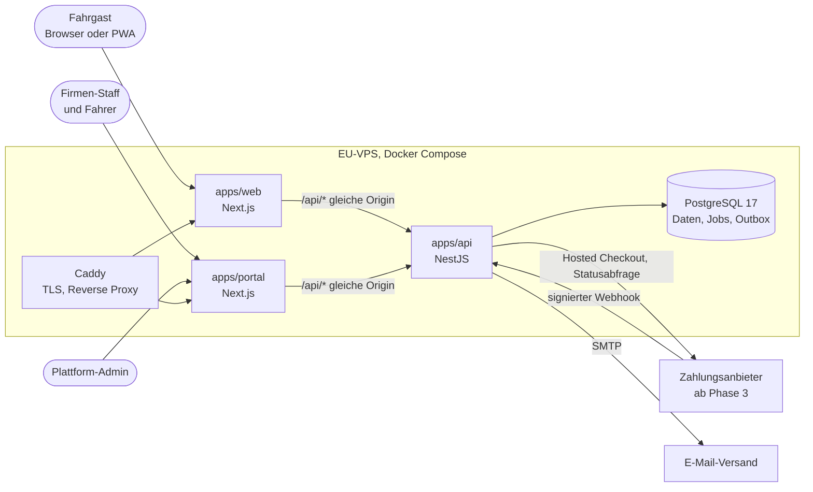

# Architektur

Stand: 2026-10-12. Die Anwendungen entstehen ab Schritt 0.5 (API) und 0.8 (Web, Portal).
Entscheidungen dazu: ADR 0002, 0003, 0004, 0009, 0010, 0014, 0015.

## Kontext



| Akteur           | Zugang                      | Darf                                                                |
| ---------------- | --------------------------- | ------------------------------------------------------------------- |
| Fahrgast (Gast)  | Web ohne Konto              | suchen, reservieren, eigene Buchung über Code und Telefon verwalten |
| Fahrgast (Konto) | Web mit Sitzung             | wie Gast, dazu Buchungshistorie                                     |
| Firmen-Staff     | Portal, E-Mail und Passwort | Daten der eigenen Firma, je nach Rolle `ADMIN` oder `AGENT`         |
| Fahrer           | Portal (Check-in-Ansicht)   | Fahrgastliste und Check-in zugewiesener Fahrten                     |
| Plattform-Admin  | Portal, Bereich `/admin`    | Firmen anlegen und sperren, Provisionssätze pflegen                 |

## Container

| Container  | Aufgabe                                                      | Technik                           |
| ---------- | ------------------------------------------------------------ | --------------------------------- |
| `web`      | Fahrgast-App, mobile-first, installierbar (PWA), ar/en       | Next.js 16, next-intl, Tailwind 4 |
| `portal`   | Firmenportal (`/company/…`) und Plattform-Admin (`/admin/…`) | Next.js 16                        |
| `api`      | Fachlogik, Auth, Jobs, Webhooks                              | NestJS 12, Prisma 7.10, pg-boss   |
| `postgres` | Daten, Job-Warteschlange, Outbox, Sitzungen                  | PostgreSQL 17                     |
| `caddy`    | TLS und Reverse Proxy (Produktion)                           | Caddy                             |
| `backup`   | verschlüsselte Sicherungen (Produktion)                      | `pg_dump` mit Verschlüsselung     |
| `mailpit`  | fängt E-Mails in der Entwicklung ab                          | Mailpit                           |

Web und Portal sind getrennt, weil Staff-Sitzungen andere Sicherheitsannahmen haben als die
öffentliche App und das Fahrgast-Bundle klein bleiben muss. Beide rufen die API über einen Rewrite
auf derselben Origin auf. Dadurch sind Cookies First-Party, und der Browser braucht kein CORS.

## Module der API

| Modul            | Verantwortung                                             |
| ---------------- | --------------------------------------------------------- |
| `auth`           | Login, Sitzungen, Passwort-Reset, Einladungen, Guards     |
| `users`          | Benutzerkonten (Staff, optional Fahrgäste)                |
| `companies`      | Mandanten, Mitglieder, Firmeneinstellungen                |
| `catalog`        | Städte, Haltestellen, Routen, Routenhalte, Tarife         |
| `fleet`          | Busse, Sitzpläne                                          |
| `trips`          | Fahrten, Fahrthalte, Kontingent, Suche                    |
| `bookings`       | Hold, Reservierung, Bestätigung, Storno, Sitzbelegung     |
| `payments`       | Zahlwege hinter `PaymentProvider`, Webhooks, Erstattungen |
| `tickets`        | Tickets, QR-Token, Check-in                               |
| `notifications`  | Outbox-Zustellung über `NotificationChannel`              |
| `reports`        | Provisionsberichte                                        |
| `admin`          | Plattform-Verwaltung                                      |
| `health`         | Liveness und Readiness                                    |
| `common`         | Guards, Pipes, Fehlerfilter, Request-Kontext              |
| `prisma`, `jobs` | Datenbankzugriff, Transaktionshelfer, Job-Warteschlange   |

## Schichten

```
Controller   HTTP, Validierung mit Zod, Guards
    ↓
Service      ein Anwendungsfall, Transaktionsgrenze
    ↓
Repository   Prisma; kritische Pfade als explizites SQL
    ↓
PostgreSQL
```

Entscheidungslogik liegt als reine Funktion in `modules/<modul>/domain/`. Sie kennt weder HTTP noch
Datenbank und ist deshalb vollständig mit Unit-Tests prüfbar.

## Datenfluss: von der Suche zum Ticket

1. Fahrgast sucht „Damaskus nach Aleppo am 20.10.". Die API sucht Fahrten, deren Einstiegshalt an
   diesem Tag in Damaskus abfährt und deren Ausstiegshalt später in Aleppo liegt.
2. Fahrgast wählt „Ich buche für: Frau" und sieht den Sitzplan mit wählbaren Sitzen.
3. Fahrgast gibt Name, Telefon und, falls die Firma es verlangt, die Ausweisnummer ein.
4. `POST /api/v1/bookings` mit Idempotenz-Schlüssel. Der Buchungsservice sperrt die Fahrt, prüft
   Segment, Tarif, Kontingent, Überlappung und Geschlechtsregel und schreibt Buchung und Belegung
   (Status `HELD`).
5. Fahrgast wählt „bar bezahlen". Die Buchung wird `RESERVED` mit Frist vor der Abfahrt.
6. Am Schalter oder beim Einsteigen bestätigt Staff die Zahlung. Die Buchung wird `CONFIRMED`, Tickets
   mit QR-Code entstehen.
7. Fahrgast öffnet das Ticket über Buchungscode und Telefon oder den Verwaltungslink. Die Seite ist
   offline anzeigbar.

## Querschnittsthemen

- **Auth:** opake Sitzungs-Tokens in PostgreSQL, Cookie für Web, `Authorization: Bearer` für eine
  spätere native App. Guard-Kette Sitzung → Rolle → Firmen-Scope.
- **Validierung:** Zod-Schemas in `packages/shared`, im Frontend und in der API dieselben.
- **Fehler:** RFC 9457 mit stabilem `code`, siehe [API-Konventionen](api-konventionen.md).
- **Logging:** strukturiert mit pino, personenbezogene Felder werden geschwärzt.
- **Jobs:** pg-boss in PostgreSQL, kein Redis. Hold-Ablauf, Outbox-Zustellung, Löschfristen, später
  Zahlungsabgleich.
- **Outbox:** ausgehende Nachrichten werden in derselben Transaktion wie die Fachänderung
  festgeschrieben und danach zugestellt. Keine Nachricht ohne Änderung, keine Änderung ohne Nachricht.
- **Externe Kanäle:** `PaymentProvider`, `OtpChannel`, `NotificationChannel` sind Schnittstellen mit
  einfachen Implementierungen für die Entwicklung.
- **Konfiguration:** Umgebungsvariablen werden beim Start mit Zod geprüft; fehlt ein Wert, startet
  die API nicht.

## Pakete

| Paket           | Inhalt                                                                                               | Nutzer           |
| --------------- | ---------------------------------------------------------------------------------------------------- | ---------------- |
| `@masar/shared` | Fehlercodes, Enums, Telefon-Normalisierung, Geld-, Zeit- und Buchungscode-Helfer; später Zod-Schemas | api, web, portal |
| `@masar/config` | ESLint- und Prettier-Basis                                                                           | alle Workspaces  |

`@masar/shared` wird mit `tsc` nach `dist/` gebaut (ESM mit Typdeklarationen). So kann die NestJS-API
es zur Laufzeit laden, und die Next-Apps brauchen keine Sonderkonfiguration.
