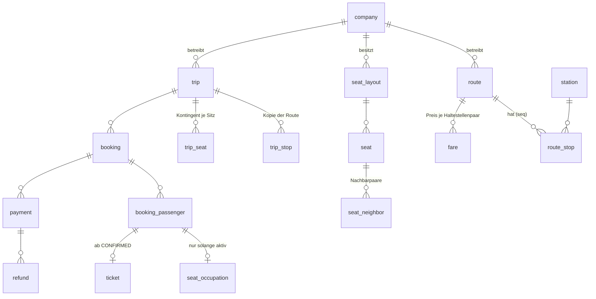
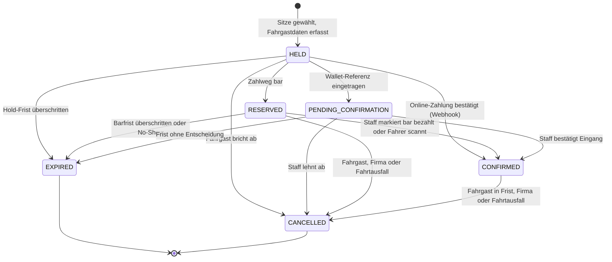

# Domänenmodell

Stand: Entwurf vom 2026-10-12, umgesetzt ab Schritt 1.1. Begriffe siehe [Glossar](glossar.md).
Entscheidungen dazu: ADR 0005 (Segmente), 0006 (Geschlechtsregel), 0007 (Kontingent),
0011 (Geld), 0012 (Zeit), 0013 (Kennungen), 0017 (Provision).

## Kernidee

Die kommerzielle Buchung und die Sitzbelegung sind getrennte Tabellen.

- `booking` und `booking_passenger` beschreiben den Kauf und bleiben als Historie erhalten.
- `seat_occupation` ist die Inventar-Wahrheit. Sie enthält genau dann Zeilen, wenn die Buchung aktiv
  ist (`HELD`, `RESERVED`, `PENDING_CONFIRMATION`, `CONFIRMED`).
- Ein Storno oder Ablauf löscht die Belegung in derselben Transaktion.

Daraus folgen drei Vorteile. Der Datenbank-Constraint gegen Überlappung braucht keine Bedingung auf
den Status. Die Geschlechtsprüfung sieht nur echte Belegungen. Ein späterer Schaltermodus schreibt in
dieselbe Tabelle und ist damit automatisch gegen Doppelbuchung geschützt.

Weitere Grundsätze:

- Eine Route hat eine feste Richtung. Die Rückfahrt ist eine eigene Route.
- `trip_stop` ist eine Kopie der Route beim Anlegen der Fahrt. Spätere Routenänderungen verändern
  bestehende Fahrten nicht.
- Der Sitzplan wird je Fahrt eingefroren. Ein Sitzplan ist unveränderlich, sobald eine Fahrt ihn
  nutzt; Änderungen erzeugen eine neue Version.

## Überblick



## Konventionen

- Primärschlüssel `uuid`, in der Anwendung als UUIDv7 erzeugt. Nach außen sichtbar ist für Buchungen
  nur der Buchungscode.
- Jede Tabelle hat `created_at` und `updated_at` als `timestamptz`.
- Jede firmeneigene Tabelle trägt `company_id` mit Index.
- Geld: `amount_minor` (Integer) plus `currency` (`char(3)`). Summen über viele Buchungen, etwa in
  Monatsberichten, als `bigint`, weil `int4` bei großen Firmen überlaufen kann.
- Mehrsprachige Namen als Spaltenpaar `name_ar`, `name_en`.
- Datenbank in `snake_case`, API in `camelCase`.

## Tabellen

| Bereich     | Tabellen und wichtige Spalten                                                                                                                                                                                                                                                                                                                                     |
| ----------- | ----------------------------------------------------------------------------------------------------------------------------------------------------------------------------------------------------------------------------------------------------------------------------------------------------------------------------------------------------------------- |
| Mandant     | `company` (slug, name_ar/en, status, gender_rule_enabled, require_national_id, hold_minutes = 15, cash_deadline_minutes = 120, online_sales_close_minutes = 30, default_currency) · `company_member` (company_id, user_id, role, status; unique je Paar) · `commission_rate` (company_id, rate_bps, valid_from, valid_until)                                      |
| Identität   | `user` (email und phone jeweils eindeutig und optional, mit verified_at; password_hash optional; preferred_locale; is_platform_admin; status) · `session` · `invitation` · `otp_challenge` (später)                                                                                                                                                               |
| Katalog     | `city` (name_ar/en, slug) · `station` (city_id, name_ar/en, owner_company_id optional, lat/lng) · `route` (company_id, name, cancellation_policy_id) · `route_stop` (route_id, station_id, seq; eindeutig je Route und seq sowie je Route und Station) · `fare` (route_id, from_route_stop_id, to_route_stop_id, amount_minor, currency, valid_from, valid_until) |
| Flotte      | `seat_layout` (company_id, name, version, pattern `2+2`/`2+1`/`custom`, status, supersedes_layout_id) · `seat` (layout_id, label, row_index, col_index, side, is_sellable; label eindeutig je Layout) · `seat_neighbor` (layout_id, seat_id, neighbor_seat_id; jedes Paar in beide Richtungen gespeichert) · `bus` (company_id, plate, seat_layout_id)            |
| Fahrt       | `trip` (company_id, route_id, seat_layout_id, bus_id, service_date, departure_at, arrival_at, status, online_sales_close_at, cash_deadline_at, gender_rule_enabled als Kopie, version) · `trip_stop` (trip_id, route_stop_id, station_id, seq, arrival_at, departure_at) · `trip_seat` (trip_id, seat_id, online_sellable, blocked)                               |
| Buchung     | `booking` (siehe unten) · `booking_passenger` (booking_id, trip_id, seat_id, full_name, gender, national_id_encrypted, national_id_key_id, national_id_last4, pii_purge_after, pii_purged_at, status) · `seat_occupation` (trip_id, seat_id, from_seq, to_seq, booking_id, booking_passenger_id eindeutig, gender)                                                |
| Zahlung     | `payment` (booking_id, company_id, provider, status, payee `COMPANY`/`PLATFORM`, amount_minor, currency, fx_rate/fx_source/fx_at optional, provider_payment_id, checkout_url, wallet_reference, idempotency_key, confirmed_by_user_id, confirmed_at, failure_code) · `refund` · `payment_webhook_event` · `company_payment_credential` (Phase 3, verschlüsselt)   |
| Ticket      | `ticket` (booking_passenger_id eindeutig, booking_id, trip_id, company_id, seat_label, qr_token_hash eindeutig, status, checked_in_at, checked_in_by, checked_in_device, version)                                                                                                                                                                                 |
| Regeln      | `cancellation_policy` (company_id, allow_passenger_cancel) · `cancellation_policy_rule` (min_minutes_before_departure, fee_bps)                                                                                                                                                                                                                                   |
| Abrechnung  | `commission_statement` (company_id, period `YYYY-MM` nach Abfahrtsmonat, status, Summen als bigint, no_show_count, cash_unconfirmed_count) · `commission_statement_line` (booking_id, ticket_amount_minor, commission_amount_minor)                                                                                                                               |
| Querschnitt | `outbox` (type, aggregate, payload, status, attempts, next_attempt_at) · `notification` (Empfänger, channel, template, locale, read_at) · `audit_log` (nur anhängen: actor, company_id, entity, action, before/after nur mit IDs und Status, reason, request_id, ip)                                                                                              |

### Buchung im Detail

`booking`: company_id, trip_id, booking_code (8 Zeichen, eindeutig), status, channel
(`ONLINE`/`COUNTER`/`ADMIN`), payment_method, from_trip_stop_id, to_trip_stop_id, from_seq, to_seq,
contact_name, contact_phone_e164, contact_email, user_id (optional), locale, hold_expires_at,
deadline_at, fare_amount_minor und total_amount_minor als Kopie zum Buchungszeitpunkt, currency,
commission_rate_bps und commission_amount_minor als Kopie bei `CONFIRMED`, manage_token_hash,
idempotency_key, confirmed_at, cancelled_at, cancelled_by, cancel_reason, version.

Alle Fahrgäste einer Buchung fahren dasselbe Segment. Das ist eine bewusste Vereinfachung.

## Zustandsautomaten

### Buchung



- Jeder Übergang in `EXPIRED` oder `CANCELLED` löscht die `seat_occupation`-Zeilen in derselben
  Transaktion.
- Der Übergang nach `CONFIRMED` erzeugt in derselben Transaktion die Tickets und friert den
  Provisionssatz ein.
- Ablauf geschieht auf zwei Wegen: ein Job prüft minütlich, und jede neue Reservierung derselben Fahrt
  gibt abgelaufene Holds unter der Sperre sofort frei. So bleibt kein Sitz blockiert, wenn der Job
  ausfällt.

### Zahlung, Erstattung, Ticket, Fahrt

| Objekt     | Übergänge                                                                                                                                                                          |
| ---------- | ---------------------------------------------------------------------------------------------------------------------------------------------------------------------------------- |
| Zahlung    | `PENDING` → `SUCCEEDED`, `FAILED`, `CANCELLED`, `EXPIRED`. Wallet zusätzlich `PENDING` → `AWAITING_REVIEW` → `SUCCEEDED` oder `REJECTED`. Abweichender Webhook → `AWAITING_REVIEW` |
| Erstattung | `REQUESTED` → `PROCESSING` → `SUCCEEDED` oder `FAILED`; bar: `MANUAL_DONE`                                                                                                         |
| Ticket     | `ISSUED` → `CHECKED_IN` (einmalig) oder `VOID`. Ein zweiter Scan ändert nichts und meldet Zeitpunkt und Gerät des ersten                                                           |
| Fahrt      | `DRAFT` → `SCHEDULED` → `DEPARTED` → `COMPLETED`; `SCHEDULED` → `CANCELLED` storniert alle aktiven Buchungen, legt Erstattungen für Online-Zahlungen an und benachrichtigt         |

Übergänge sind reine Funktionen (`canTransition(from, to)`). Eine Wiederholung desselben Übergangs,
etwa durch einen doppelten Webhook, ist ein No-op.

Sonderfall „bezahlt nach Ablauf": Kommt eine Zahlungsbestätigung nach dem Ablauf des Holds, versucht
das System unter der Sperre, die Sitze neu zu belegen. Gelingt das nicht, entsteht automatisch eine
Erstattung und eine Benachrichtigung.

## Invarianten

| Invariante                                                    | Durchsetzung                                                                                                                                                |
| ------------------------------------------------------------- | ----------------------------------------------------------------------------------------------------------------------------------------------------------- |
| Kein Sitz doppelt auf überlappenden Segmenten derselben Fahrt | Datenbank: EXCLUDE-Constraint (siehe unten). Anwendung: Prüfung unter der Trip-Sperre für gute Fehlermeldungen                                              |
| Geschlechtsregel                                              | Nur in der Anwendung unter der Trip-Sperre; kein Datenbank-Constraint möglich                                                                               |
| Online-Kontingent                                             | Kanal `ONLINE` verlangt `online_sellable` und nicht `blocked`; `COUNTER`/`ADMIN` ignorieren `online_sellable`, respektieren `blocked`                       |
| Buchungscode eindeutig und nicht erratbar                     | 8 Zeichen Crockford-Base32 aus kryptografischem Zufall, Unique-Index, bei Kollision neu würfeln                                                             |
| Webhook wirkt höchstens einmal                                | `payment_webhook_event` mit eindeutigem Paar aus Anbieter und Ereignis-ID; Duplikat liefert 200 ohne Wirkung                                                |
| Keine Buchung auf der Fahrt einer fremden Firma               | Zusammengesetzte Fremdschlüssel `(trip_id, company_id)` auf booking, ticket, payment                                                                        |
| Weitere                                                       | `from_seq < to_seq`; Gesamtbetrag = Tarif × Fahrgäste; Zahlungsbetrag = Buchungsbetrag; Tickets nur bei `CONFIRMED`; Sitzplan unveränderlich, sobald belegt |

### Überlappung in der Datenbank

```sql
CREATE EXTENSION IF NOT EXISTS btree_gist;

ALTER TABLE seat_occupation
  ADD CONSTRAINT seat_occupation_seq_order CHECK (from_seq < to_seq),
  ADD CONSTRAINT seat_occupation_no_overlap
    EXCLUDE USING gist (
      trip_id WITH =,
      seat_id WITH =,
      int4range(from_seq, to_seq, '[)') WITH &&
    );
```

Segmente sind halboffen. `[0,2)` (Damaskus bis Hama) und `[2,4)` (Hama bis Aleppo) überlappen nicht;
derselbe Sitz kann in Hama neu besetzt werden. `[0,3)` und `[2,4)` überlappen.

Prisma kennt diesen Constraint nicht. Er entsteht in einer handgeschriebenen Migration. Ein
Integrationstest prüft seine Existenz in `pg_constraint`, und ein zweiter Test fügt absichtlich an der
Anwendung vorbei eine Überlappung ein und erwartet SQLSTATE `23P01`.

### Geschlechtsregel

Gilt nur, wenn die Fahrt die Regel aktiviert hat (Kopie der Firmeneinstellung beim Anlegen).

- Zwei Sitze sind Nachbarn, wenn `seat_neighbor` das Paar enthält. Der Sitzplan-Generator erzeugt die Paare (siehe Sitzpläne).
- Konflikt: Ein Nachbarsitz ist auf einem überlappenden Segment von einer anderen Buchung belegt, und
  das Geschlecht unterscheidet sich. Eine fehlende Angabe im Bestand zählt als Konflikt.
- Fahrgäste derselben Buchung sind ausgenommen (Familie, Paare).
- Die Oberfläche fragt zuerst, für wen gebucht wird, und zeigt dann je Sitz nur „wählbar" oder „nicht
  wählbar". Das Geschlecht eines anderen Fahrgasts wird nie ausdrücklich angezeigt.

## Kritische Transaktion „Sitz reservieren"

Reihenfolge: sperren, frisch lesen, prüfen, schreiben. Isolationsstufe Read Committed, die Trip-Zeile
ist der Serialisierungspunkt je Fahrt.

1. Idempotenz vor der Sperre: Gibt es bereits eine Buchung mit diesem Idempotenz-Schlüssel, wird sie
   zurückgegeben.
2. `SELECT … FROM trip WHERE id = $1 FOR UPDATE`. Status muss `SCHEDULED` sein, der Online-Verkauf
   offen.
3. Abgelaufene Holds dieser Fahrt auf `EXPIRED` setzen und ihre Belegungen löschen.
4. Frisch lesen: Fahrthalte (Segment auflösen), Tarif für das Haltestellenpaar am Fahrtag, Sitze mit
   Kontingent und Sperre.
5. Prüfen: Überlappung in `seat_occupation`, dann bei aktiver Regel das Geschlecht je Fahrgast.
6. Schreiben: Buchung (`HELD`), Fahrgäste (Ausweisnummer verschlüsselt), Belegungen, Audit-Eintrag,
   Outbox-Eintrag.
7. Fehler außen abbilden: `23P01` → 409 `SEAT_TAKEN`; Kollision des Buchungscodes → neu würfeln
   (höchstens dreimal); Kollision des Idempotenz-Schlüssels → bestehende Buchung; Transaktions-
   Timeout → 503 mit `Retry-After`.

Warum Sperre und Constraint zugleich: Die Sperre liefert verständliche Fehler und ist die einzige
Serialisierung für die Geschlechtsregel. Der Constraint schützt die Eindeutigkeit gegen jeden
Schreibpfad, der die Sperre vergisst, etwa Admin-Skripte oder einen späteren Schaltermodus.

## Suche und Tarif

- Die Suche „Stadt A nach Stadt B am Tag D" interpretiert D in `Asia/Damascus` und filtert über die
  Abfahrt am Einstiegshalt, nicht über den Fahrtag der Fahrt. Eine Nachtfahrt ab Damaskus um 23:00
  erreicht Homs nach Mitternacht und erscheint für Homs nach Aleppo am Folgetag.
- Der Einstiegshalt muss in der Folge vor dem Ausstiegshalt liegen.
- Ohne gültigen Tarif für das Haltestellenpaar erscheint die Fahrt für dieses Paar nicht. Das Portal
  warnt beim Veröffentlichen einer Fahrt mit Tariflücken.
- Die Zahl freier Sitze wird gekappt angezeigt („9+"), damit die Auslastung nicht ausgelesen werden
  kann.
- Sitzplan für Fahrt, Segment und gewähltes Geschlecht: je Sitz `FREE`, `TAKEN`, `NOT_ONLINE`,
  `BLOCKED` oder `NOT_FOR_YOU`.

## Sitzpläne

- Ein Generator erzeugt Standardlayouts und ihre Nachbarpaare (`seat_neighbor`, ADR 0006). 2+2: je Reihe
  ein Paar links und ein Paar rechts vom Gang. 2+1 (VIP): ein Paar auf der Doppelseite, der Einzelsitz
  hat keinen Nachbarn. Hinterbank mit fünf Sitzen: eine Kette 1–2, 2–3, 3–4, 4–5; der mittlere Sitz hat
  zwei Nachbarn.
- Nachbarschaft ist ein Graph, keine Einteilung in Gruppen. Mit Gruppen je Reihenseite hätte der
  mittlere Sitz der Hinterbank keinen Nachbarn, und die Geschlechtsregel würde dort nicht greifen.
- Die Beschriftung (`label`) wird gespeichert, nicht berechnet, damit die Firma ihre eigene
  Nummerierung übernehmen kann.
- Busaustausch am Fahrtag ist im MVP nur bei gleichem Layout möglich.

## Provision

- Basis: alle bestätigten Buchungen über die App; bar zählt ab Bestätigung durch Staff oder Scan.
- Zeitraum: Monat der Abfahrt der Fahrt (Leistungsmonat). Stornierte Buchungen erzeugen nie eine
  Zeile.
- Der Satz wird bei `CONFIRMED` eingefroren. Ein ausgegebener Bericht ist unveränderlich;
  Korrekturen, etwa eine Erstattung nach der Fahrt, erscheinen als Korrekturzeile im nächsten
  offenen Monat.
- Der Bericht zeigt je Firma die Quote nicht bestätigter Barreservierungen, damit eine Umgehung der
  Provision sichtbar wird.
