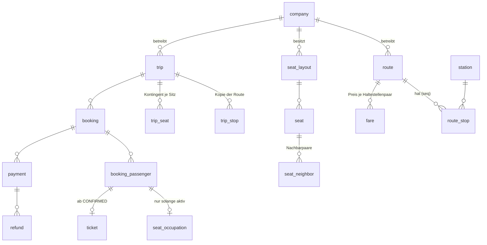
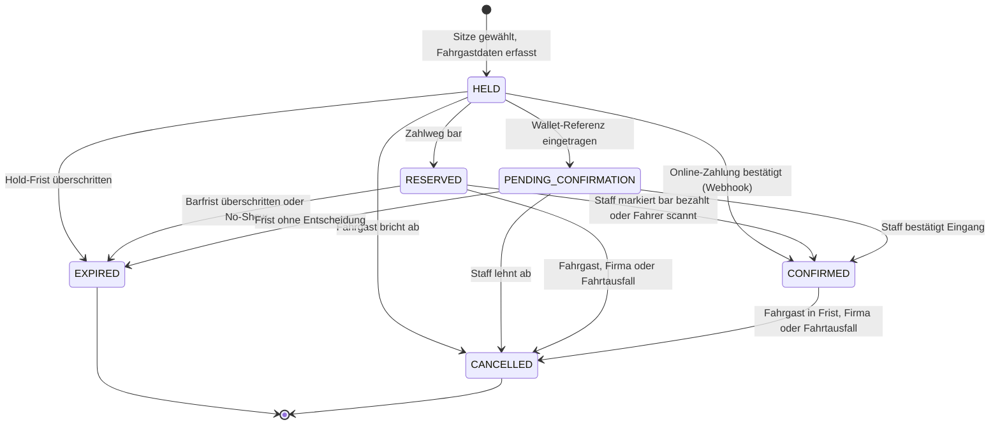

# Domänenmodell

Stand: Entwurf vom 2026-10-12, umgesetzt in Schritt 1.1 (siehe [Umsetzung 1.1](#umsetzung-11)),
Suche und Sitzplan in Schritt 1.2 (siehe [Umsetzung 1.2](#umsetzung-12)), Buchungskern in
Schritt 1.3 (siehe [Umsetzung 1.3](#umsetzung-13)), Flotte in Schritt 2.2 (siehe
[Umsetzung 2.2](#umsetzung-22)).
Begriffe siehe [Glossar](glossar.md). Entscheidungen dazu: ADR 0005 (Segmente), 0006
(Geschlechtsregel), 0007 (Kontingent), 0011 (Geld), 0012 (Zeit), 0013 (Kennungen), 0017
(Provision), 0018 (zusammengesetzte Fremdschlüssel), 0020 (Gastzugriff), 0021 (Hintergrundjobs).

## Kernidee

Die kommerzielle Buchung und die Sitzbelegung sind getrennte Tabellen.

- `booking` und `booking_passenger` beschreiben den Kauf und bleiben als Historie erhalten.
- `seat_occupation` ist die Inventar-Wahrheit. Sie enthält genau dann Zeilen, wenn die Buchung aktiv
  ist (`HELD`, `RESERVED`, `PENDING_CONFIRMATION`, `CONFIRMED`).
- Ein Storno oder Ablauf löscht die Belegung in derselben Transaktion.

Daraus folgen drei Vorteile. Der Datenbank-Constraint gegen Überlappung braucht keine Bedingung auf
den Status. Die Geschlechtsprüfung sieht nur echte Belegungen. Ein späterer Schaltermodus schreibt in
dieselbe Tabelle und ist damit automatisch gegen Doppelbuchung geschützt.

Weitere Grundsätze:

- Eine Route hat eine feste Richtung. Die Rückfahrt ist eine eigene Route.
- `trip_stop` ist eine Kopie der Route beim Anlegen der Fahrt. Spätere Routenänderungen verändern
  bestehende Fahrten nicht.
- Der Sitzplan wird je Fahrt eingefroren. Ein Sitzplan ist unveränderlich, sobald eine Fahrt ihn
  nutzt; Änderungen erzeugen eine neue Version.

## Überblick



## Konventionen

- Primärschlüssel `uuid`, in der Anwendung als UUIDv7 erzeugt. Nach außen sichtbar ist für Buchungen
  nur der Buchungscode.
- Jede Tabelle hat `created_at` und `updated_at` als `timestamptz`.
- Jede firmeneigene Tabelle trägt `company_id` mit Index.
- Geld: `amount_minor` (Integer) plus `currency` (`char(3)`). Summen über viele Buchungen, etwa in
  Monatsberichten, als `bigint`, weil `int4` bei großen Firmen überlaufen kann.
- Mehrsprachige Namen als Spaltenpaar `name_ar`, `name_en`.
- Datenbank in `snake_case`, API in `camelCase`.

## Tabellen

| Bereich     | Tabellen und wichtige Spalten                                                                                                                                                                                                                                                                                                                                     |
| ----------- | ----------------------------------------------------------------------------------------------------------------------------------------------------------------------------------------------------------------------------------------------------------------------------------------------------------------------------------------------------------------- |
| Mandant     | `company` (slug, name_ar/en, status, gender_rule_enabled, require_national_id, hold_minutes = 15, cash_deadline_minutes = 120, online_sales_close_minutes = 30, default_currency) · `company_member` (company_id, user_id, role, status; unique je Paar) · `commission_rate` (company_id, rate_bps, valid_from, valid_until)                                      |
| Identität   | `user` (email und phone jeweils eindeutig und optional, mit verified_at; password_hash optional; preferred_locale; is_platform_admin; status) · `session` · `invitation` · `otp_challenge` (später)                                                                                                                                                               |
| Katalog     | `city` (name_ar/en, slug) · `station` (city_id, name_ar/en, owner_company_id optional, lat/lng) · `route` (company_id, name, cancellation_policy_id) · `route_stop` (route_id, station_id, seq; eindeutig je Route und seq sowie je Route und Station) · `fare` (route_id, from_route_stop_id, to_route_stop_id, amount_minor, currency, valid_from, valid_until) |
| Flotte      | `seat_layout` (company_id, name, version, pattern `2+2`/`2+1`/`custom`, status, supersedes_layout_id) · `seat` (layout_id, label, row_index, col_index, side, is_sellable; label eindeutig je Layout) · `seat_neighbor` (layout_id, seat_id, neighbor_seat_id; jedes Paar in beide Richtungen gespeichert) · `bus` (company_id, plate, seat_layout_id)            |
| Fahrt       | `trip` (company_id, route_id, seat_layout_id, bus_id, service_date, departure_at, arrival_at, status, online_sales_close_at, cash_deadline_at, gender_rule_enabled als Kopie, version) · `trip_stop` (trip_id, route_stop_id, station_id, seq, arrival_at, departure_at) · `trip_seat` (trip_id, seat_id, online_sellable, blocked)                               |
| Buchung     | `booking` (siehe unten) · `booking_passenger` (booking_id, trip_id, seat_id, full_name, gender, national_id_encrypted, national_id_key_id, national_id_last4, pii_purge_after, pii_purged_at, status) · `seat_occupation` (trip_id, seat_id, from_seq, to_seq, booking_id, booking_passenger_id eindeutig, gender)                                                |
| Zahlung     | `payment` (booking_id, company_id, provider, status, payee `COMPANY`/`PLATFORM`, amount_minor, currency, fx_rate/fx_source/fx_at optional, provider_payment_id, checkout_url, wallet_reference, idempotency_key, confirmed_by_user_id, confirmed_at, failure_code) · `refund` · `payment_webhook_event` · `company_payment_credential` (Phase 3, verschlüsselt)   |
| Ticket      | `ticket` (booking_passenger_id eindeutig, booking_id, trip_id, company_id, seat_label, qr_token_hash eindeutig, status, checked_in_at, checked_in_by, checked_in_device, version)                                                                                                                                                                                 |
| Regeln      | `cancellation_policy` (company_id, allow_passenger_cancel) · `cancellation_policy_rule` (min_minutes_before_departure, fee_bps)                                                                                                                                                                                                                                   |
| Abrechnung  | `commission_statement` (company_id, period `YYYY-MM` nach Abfahrtsmonat, status, Summen als bigint, no_show_count, cash_unconfirmed_count) · `commission_statement_line` (booking_id, ticket_amount_minor, commission_amount_minor)                                                                                                                               |
| Querschnitt | `outbox` (type, aggregate, payload, status, attempts, next_attempt_at) · `notification` (Empfänger, channel, template, locale, read_at) · `audit_log` (nur anhängen: actor, company_id, entity, action, before/after nur mit IDs und Status, reason, request_id, ip)                                                                                              |

### Buchung im Detail

`booking`: company_id, trip_id, booking_code (8 Zeichen, eindeutig), status, channel
(`ONLINE`/`COUNTER`/`ADMIN`), payment_method, from_trip_stop_id, to_trip_stop_id, from_seq, to_seq,
contact_name, contact_phone_e164, contact_email, user_id (optional), locale, hold_expires_at,
deadline_at, fare_amount_minor und total_amount_minor als Kopie zum Buchungszeitpunkt, currency,
commission_rate_bps und commission_amount_minor als Kopie bei `CONFIRMED`, manage_token_hash,
idempotency_key, confirmed_at, cancelled_at, cancelled_by, cancel_reason, version.

Alle Fahrgäste einer Buchung fahren dasselbe Segment. Das ist eine bewusste Vereinfachung.

## Zustandsautomaten

### Buchung



- Jeder Übergang in `EXPIRED` oder `CANCELLED` löscht die `seat_occupation`-Zeilen in derselben
  Transaktion.
- Der Übergang nach `CONFIRMED` erzeugt in derselben Transaktion die Tickets und friert den
  Provisionssatz ein.
- Ablauf geschieht auf zwei Wegen: ein Job prüft minütlich, und jede neue Reservierung derselben Fahrt
  gibt abgelaufene Holds unter der Sperre sofort frei. So bleibt kein Sitz blockiert, wenn der Job
  ausfällt.

### Zahlung, Erstattung, Ticket, Fahrt

| Objekt     | Übergänge                                                                                                                                                                          |
| ---------- | ---------------------------------------------------------------------------------------------------------------------------------------------------------------------------------- |
| Zahlung    | `PENDING` → `SUCCEEDED`, `FAILED`, `CANCELLED`, `EXPIRED`. Wallet zusätzlich `PENDING` → `AWAITING_REVIEW` → `SUCCEEDED` oder `REJECTED`. Abweichender Webhook → `AWAITING_REVIEW` |
| Erstattung | `REQUESTED` → `PROCESSING` → `SUCCEEDED` oder `FAILED`; bar: `MANUAL_DONE`                                                                                                         |
| Ticket     | `ISSUED` → `CHECKED_IN` (einmalig) oder `VOID`. Ein zweiter Scan ändert nichts und meldet Zeitpunkt und Gerät des ersten                                                           |
| Fahrt      | `DRAFT` → `SCHEDULED` → `DEPARTED` → `COMPLETED`; `SCHEDULED` → `CANCELLED` storniert alle aktiven Buchungen, legt Erstattungen für Online-Zahlungen an und benachrichtigt         |

Übergänge sind reine Funktionen (`canTransition(from, to)`). Eine Wiederholung desselben Übergangs,
etwa durch einen doppelten Webhook, ist ein No-op.

Sonderfall „bezahlt nach Ablauf": Kommt eine Zahlungsbestätigung nach dem Ablauf des Holds, versucht
das System unter der Sperre, die Sitze neu zu belegen. Gelingt das nicht, entsteht automatisch eine
Erstattung und eine Benachrichtigung.

## Invarianten

| Invariante                                                    | Durchsetzung                                                                                                                                                |
| ------------------------------------------------------------- | ----------------------------------------------------------------------------------------------------------------------------------------------------------- |
| Kein Sitz doppelt auf überlappenden Segmenten derselben Fahrt | Datenbank: EXCLUDE-Constraint (siehe unten). Anwendung: Prüfung unter der Trip-Sperre für gute Fehlermeldungen                                              |
| Geschlechtsregel                                              | Nur in der Anwendung unter der Trip-Sperre; kein Datenbank-Constraint möglich                                                                               |
| Online-Kontingent                                             | Kanal `ONLINE` verlangt `online_sellable` und nicht `blocked`; `COUNTER`/`ADMIN` ignorieren `online_sellable`, respektieren `blocked`                       |
| Buchungscode eindeutig und nicht erratbar                     | 8 Zeichen Crockford-Base32 aus kryptografischem Zufall, Unique-Index, bei Kollision neu würfeln                                                             |
| Webhook wirkt höchstens einmal                                | `payment_webhook_event` mit eindeutigem Paar aus Anbieter und Ereignis-ID; Duplikat liefert 200 ohne Wirkung                                                |
| Keine Buchung auf der Fahrt einer fremden Firma               | Zusammengesetzte Fremdschlüssel `(trip_id, company_id)` auf booking, ticket, payment                                                                        |
| Weitere                                                       | `from_seq < to_seq`; Gesamtbetrag = Tarif × Fahrgäste; Zahlungsbetrag = Buchungsbetrag; Tickets nur bei `CONFIRMED`; Sitzplan unveränderlich, sobald belegt |

### Überlappung in der Datenbank

```sql
CREATE EXTENSION IF NOT EXISTS btree_gist;

ALTER TABLE seat_occupation
  ADD CONSTRAINT seat_occupation_seq_order CHECK (from_seq < to_seq),
  ADD CONSTRAINT seat_occupation_no_overlap
    EXCLUDE USING gist (
      trip_id WITH =,
      seat_id WITH =,
      int4range(from_seq, to_seq, '[)') WITH &&
    );
```

Segmente sind halboffen. `[0,2)` (Damaskus bis Hama) und `[2,4)` (Hama bis Aleppo) überlappen nicht;
derselbe Sitz kann in Hama neu besetzt werden. `[0,3)` und `[2,4)` überlappen.

Prisma kennt diesen Constraint nicht. Er entsteht in einer handgeschriebenen Migration. Ein
Integrationstest prüft seine Existenz in `pg_constraint`, und ein zweiter Test fügt absichtlich an der
Anwendung vorbei eine Überlappung ein und erwartet SQLSTATE `23P01`.

### Geschlechtsregel

Gilt nur, wenn die Fahrt die Regel aktiviert hat (Kopie der Firmeneinstellung beim Anlegen).

- Zwei Sitze sind Nachbarn, wenn `seat_neighbor` das Paar enthält. Der Sitzplan-Generator erzeugt die Paare (siehe Sitzpläne).
- Konflikt: Ein Nachbarsitz ist auf einem überlappenden Segment von einer anderen Buchung belegt, und
  das Geschlecht unterscheidet sich. Eine fehlende Angabe im Bestand zählt als Konflikt.
- Fahrgäste derselben Buchung sind ausgenommen (Familie, Paare).
- Die Oberfläche fragt zuerst, für wen gebucht wird, und zeigt dann je Sitz nur „wählbar" oder „nicht
  wählbar". Das Geschlecht eines anderen Fahrgasts wird nie ausdrücklich angezeigt.

## Kritische Transaktion „Sitz reservieren"

Reihenfolge: sperren, frisch lesen, prüfen, schreiben. Isolationsstufe Read Committed, die Trip-Zeile
ist der Serialisierungspunkt je Fahrt.

1. Idempotenz vor der Sperre: Gibt es bereits eine Buchung mit diesem Idempotenz-Schlüssel, wird sie
   zurückgegeben.
2. `SELECT … FROM trip WHERE id = $1 FOR UPDATE`. Status muss `SCHEDULED` sein, der Online-Verkauf
   offen.
3. Abgelaufene Holds dieser Fahrt auf `EXPIRED` setzen und ihre Belegungen löschen.
4. Frisch lesen: Fahrthalte (Segment auflösen), Tarif für das Haltestellenpaar am Fahrtag, Sitze mit
   Kontingent und Sperre.
5. Prüfen: Überlappung in `seat_occupation`, dann bei aktiver Regel das Geschlecht je Fahrgast.
6. Schreiben: Buchung (`HELD`), Fahrgäste (Ausweisnummer verschlüsselt), Belegungen, Audit-Eintrag,
   Outbox-Eintrag.
7. Fehler außen abbilden: `23P01` → 409 `SEAT_TAKEN`; Kollision des Buchungscodes → neu würfeln
   (höchstens dreimal); Kollision des Idempotenz-Schlüssels → bestehende Buchung; Transaktions-
   Timeout → 503 mit `Retry-After`.

Warum Sperre und Constraint zugleich: Die Sperre liefert verständliche Fehler und ist die einzige
Serialisierung für die Geschlechtsregel. Der Constraint schützt die Eindeutigkeit gegen jeden
Schreibpfad, der die Sperre vergisst, etwa Admin-Skripte oder einen späteren Schaltermodus.

## Suche und Tarif

- Die Suche „Stadt A nach Stadt B am Tag D" interpretiert D in `Asia/Damascus` und filtert über die
  Abfahrt am Einstiegshalt, nicht über den Fahrtag der Fahrt. Eine Nachtfahrt ab Damaskus um 23:00
  erreicht Homs nach Mitternacht und erscheint für Homs nach Aleppo am Folgetag.
- Der Einstiegshalt muss in der Folge vor dem Ausstiegshalt liegen.
- Ohne gültigen Tarif für das Haltestellenpaar erscheint die Fahrt für dieses Paar nicht. Das Portal
  warnt beim Veröffentlichen einer Fahrt mit Tariflücken.
- Die Zahl freier Sitze wird gekappt angezeigt („9+"), damit die Auslastung nicht ausgelesen werden
  kann.
- Sitzplan für Fahrt, Segment und gewähltes Geschlecht: je Sitz `FREE`, `TAKEN`, `NOT_ONLINE`,
  `BLOCKED` oder `NOT_FOR_YOU`.

## Sitzpläne

- Ein Generator erzeugt Standardlayouts und ihre Nachbarpaare (`seat_neighbor`, ADR 0006). 2+2: je Reihe
  ein Paar links und ein Paar rechts vom Gang. 2+1 (VIP): ein Paar auf der Doppelseite, der Einzelsitz
  hat keinen Nachbarn. Hinterbank mit fünf Sitzen: eine Kette 1–2, 2–3, 3–4, 4–5; der mittlere Sitz hat
  zwei Nachbarn.
- Nachbarschaft ist ein Graph, keine Einteilung in Gruppen. Mit Gruppen je Reihenseite hätte der
  mittlere Sitz der Hinterbank keinen Nachbarn, und die Geschlechtsregel würde dort nicht greifen.
- Die Beschriftung (`label`) wird gespeichert, nicht berechnet, damit die Firma ihre eigene
  Nummerierung übernehmen kann.
- Busaustausch am Fahrtag ist im MVP nur bei gleichem Layout möglich.

## Provision

- Basis: alle bestätigten Buchungen über die App; bar zählt ab Bestätigung durch Staff oder Scan.
- Zeitraum: Monat der Abfahrt der Fahrt (Leistungsmonat). Stornierte Buchungen erzeugen nie eine
  Zeile.
- Der Satz wird bei `CONFIRMED` eingefroren. Ein ausgegebener Bericht ist unveränderlich;
  Korrekturen, etwa eine Erstattung nach der Fahrt, erscheinen als Korrekturzeile im nächsten
  offenen Monat.
- Der Bericht zeigt je Firma die Quote nicht bestätigter Barreservierungen, damit eine Umgehung der
  Provision sichtbar wird.

## Umsetzung 1.1

Stand 2026-11-02. Schema: `apps/api/prisma/schema.prisma`, Migration
`20261102040000_katalog_flotte_fahrten_buchung`. Architekturrelevante Entscheidungen stehen in
ADR 0018; hier die Abweichungen und Annahmen gegenüber dem Entwurf oben.

### Handgeschriebenes SQL in der Migration

| Objekt                                                             | Zweck                                                                                                                                                           |
| ------------------------------------------------------------------ | --------------------------------------------------------------------------------------------------------------------------------------------------------------- |
| `seat_occupation_no_overlap`, `seat_occupation_seq_order`          | wie oben unter „Überlappung in der Datenbank"                                                                                                                   |
| `fare_no_overlap`                                                  | je Haltestellenpaar höchstens ein gültiger Tarif pro Fahrtag                                                                                                    |
| `commission_rate_no_overlap`                                       | je Firma höchstens ein Provisionssatz pro Fahrtag                                                                                                               |
| CHECK-Constraints (Liste in `apps/api/test/inventory.e2e.test.ts`) | Folge `from_seq < to_seq`, Beträge ≥ 0, Währung `^[A-Z]{3}$`, Buchungscode im Crockford-Alphabet, Zeitstempel je Status, Koordinaten, Prozentwerte 0–10 000 bps |
| `REVOKE DELETE` für `masar_app`                                    | `booking`, `booking_passenger`, `ticket`, `payment`, `refund`, `payment_webhook_event` sind Historie                                                            |

`btree_gist` legt bereits die erste Migration an (ADR 0004, Nachtrag 0.6); Schritt 1.1 braucht
deshalb keine Änderung an `docker/postgres/initdb/01-roles.sh` oder an CI.

### Abweichungen und Ergänzungen

- **Zusammengesetzte Fremdschlüssel** über Firma hinaus auch für Teilstrecke, Sitzplan und Bus
  (ADR 0018). `payment` hat keine `trip_id`; die Firma folgt über `(booking_id, company_id)`.
- **`trip_seat.seat_layout_id`** ist neu (redundant zu `trip`, über Fremdschlüssel gleich gehalten).
  `online_sellable` hat keinen Standardwert, jede Fahrt setzt ihr Kontingent ausdrücklich (ADR 0007).
- **Enum-Werte:** Sitzseite `LEFT`, `RIGHT`, `BENCH` (Hinterbank). Layoutmuster als
  `TWO_PLUS_TWO`, `TWO_PLUS_ONE`, `CUSTOM`, weil Prisma `2+2` nicht als Bezeichner erlaubt; der
  Generator (`modules/fleet/domain/seat-layout-generator.ts`) arbeitet weiter mit `'2+2'`/`'2+1'`.
  Layoutstatus `DRAFT`, `ACTIVE`, `RETIRED`. Fahrgaststatus `ACTIVE`, `CANCELLED` (Teilstorno
  später). Outbox `PENDING`, `DONE`, `FAILED`. Zahlweg und Anbieter teilen das Enum
  `PaymentMethod` (`CASH`, `WALLET_TRANSFER`, `ECASH`, `INTL_CARD`); die Spalte heißt auf `payment`
  `method`, auf `payment_webhook_event` `provider`.
- **Route:** Name als Paar `name_ar`/`name_en` (Konvention mehrsprachiger Namen), dazu `is_active`.
  `cancellation_policy_id` ist Pflicht.
- **Tarif und Provisionssatz:** `valid_from`/`valid_until` sind Kalendertage (`date`) und gelten für
  den Fahrtag (`trip.service_date`, ADR 0012) im halboffenen Bereich; `valid_until` leer heißt
  unbefristet.
- **Buchung:** zusätzlich `cancelled_by_user_id` neben `cancelled_by` (`PASSENGER`, `COMPANY`,
  `SYSTEM`) und `pii_purge_after`/`pii_purged_at` für die Kontaktdaten (Name, Telefon, E-Mail
  unterliegen derselben Frist wie die Fahrgastdaten, ADR 0016). `contact_email` muss normalisiert
  sein (wie bei `user`).
- **Fahrgast:** Ausweisnummer nur als Spalten (`national_id_encrypted` bytea, `national_id_key_id`,
  `national_id_last4`); die Verschlüsselung folgt mit dem Buchungskern (1.3). Ein Fahrgast hat je
  Buchung genau einen Sitz (`unique (booking_id, seat_id)`).
- **Zahlung:** `idempotency_key` Pflicht und eindeutig; `unique (method, provider_payment_id)` und
  `unique (company_id, method, wallet_reference)` (ADR 0008). Fremdwährung: `fx_rate`
  (`numeric(20,10)`), `fx_source` und `fx_at` nur gemeinsam.
- **Erstattung** trägt `company_id` und `booking_id`, damit Abrechnung und Mandantenprüfung ohne Join
  über die Zahlung auskommen.
- **Handelnde Personen** (`confirmed_by_user_id`, `checked_in_by_user_id`, `cancelled_by_user_id`,
  `requested_by_user_id`) sind UUIDs ohne Fremdschlüssel, wie `audit_log.actor_id`: Ein späteres
  Löschen eines Kontos soll Historie nicht blockieren.
- **Schlanke Tabellen** (Annahme, mit Phase 4 zu schärfen): `commission_statement` je Firma, Monat
  und Währung mit `bigint`-Summen; `commission_statement_line` mit Art `REGULAR`/`CORRECTION`
  (Korrekturen dürfen negativ sein); `notification` an ein Konto oder an den Kontakt einer Buchung,
  nur Vorlage, Sprache und IDs, kein gerenderter Text.
- **`seat_neighbor`** trägt `layout_id`; beide Sitze müssen zum selben Plan gehören. Die Symmetrie
  (beide Richtungen) erzwingt die Datenbank nicht, sie ist Pflicht jedes Schreibpfads.
- **Stornoregel:** `cancellation_policy` hat zusätzlich `name`. Eine Stufe gilt ab
  `min_minutes_before_departure`; maßgeblich ist die größte erreichte Stufe.

### Seed

`pnpm --filter @masar/api db:seed` (Code in `apps/api/prisma/seed.ts` und `prisma/seed/demo.ts`):
erfundene Firma `demo-pullman` („Masar Demo Pullman"), Städte Damaskus, Homs, Hama, Aleppo mit je
einer erfundenen Haltestelle ohne Koordinaten, Route über alle vier mit sechs Tarifen (250 bis
600 SYP), Sitzplan „Standard 45" (2+2, zehn Reihen, Hinterbank mit fünf Sitzen) aus dem
Generator, Bus `DEMO-001`, Stornoregel und 3 % Provision (Platzhalter). Fahrten an sieben Tagen ab
heute um 07:00, 15:00 und 23:00 Ortszeit; Kontingent: Reihen 9 und 10 nur am Schalter, Sitz 9A
gesperrt. Keine Buchungen, keine Personendaten. Ein Demo-Konto entsteht nur mit
`SEED_STAFF_EMAIL` und `SEED_STAFF_PASSWORD`. Der Seed ist idempotent; Fahrten früherer Tage
bleiben stehen.

## Umsetzung 1.2

Stand 2026-11-02. Code: `apps/api/src/modules/trips` (Suche, Sitzplan) und
`apps/api/src/modules/catalog` (Städte). Format der Endpunkte: [API-Konventionen](api-konventionen.md#suche-und-sitzplan).
Keine Schemaänderung: Die Suche nutzt den vorhandenen Index `trip_stop (station_id, departure_at)`.

### Reine Funktionen (`modules/trips/domain/`)

| Datei              | Inhalt                                                                              |
| ------------------ | ----------------------------------------------------------------------------------- |
| `search-day.ts`    | Suchtag als halboffenes UTC-Intervall über die IANA-Zone `Asia/Damascus`            |
| `segment.ts`       | Teilstrecke aus Einstiegs- und Ausstiegshalt auflösen, Überlappung halboffen prüfen |
| `seat-map.ts`      | Sitzstatus aus Kontingent, Belegung, Nachbarpaaren und Geschlecht                   |
| `availability.ts`  | Kappung freier Sitze („9+")                                                         |
| `search-cursor.ts` | opaker Cursor für die Keyset-Paginierung der Suche                                  |

### Entscheidungen und Annahmen

- **Suche nach Stadt, nicht nach Haltestelle.** Einstieg ist jeder Fahrthalt in der Startstadt,
  Ausstieg jeder spätere Halt in der Zielstadt. Ein Treffer je Fahrt und Haltestellenpaar: Hat eine
  Stadt zwei Haltestellen auf der Route, erscheinen beide Paare.
- **Sichtbarkeit:** nur Fahrten mit Status `SCHEDULED`, `online_sales_close_at` in der Zukunft und
  aktiver Firma. Der Verkaufsschluss gilt je Fahrt, nicht je Einstiegshalt.
- **Tarif:** gültig, wenn `valid_from ≤ service_date < valid_until` (oder unbefristet). Maßgeblich
  ist der Fahrtag am Starthalt, auch wenn der Einstieg nach Mitternacht liegt (ADR 0012).
- **Freie Sitze in der Suche:** Sitze mit `online_sellable`, nicht `blocked`, `is_sellable` und ohne
  überlappende Belegung. Die Geschlechtsregel zählt hier nicht mit, weil die Suche das Geschlecht
  nicht kennt; der Sitzplan zeigt danach die wählbaren Sitze. Kappung bei 9, gleich der Höchstzahl
  an Fahrgästen je Suche (`passengers` 1 bis 9). Exakt 9 erscheint deshalb ebenfalls als „9+".
- **Vorrang der Sitzstatus:** `BLOCKED` (gesperrt, `is_sellable` falsch oder ohne Kontingentzeile) vor
  `NOT_ONLINE` vor `TAKEN` vor `NOT_FOR_YOU` vor `FREE`. `NOT_ONLINE` steht vor `TAKEN`, damit
  spätere Schalterbuchungen (Phase 2) online nicht als Belegung sichtbar werden.
- **Geschlechtsregel im Sitzplan:** nur, wenn die Fahrt sie aktiviert hat und die Anfrage `gender`
  nennt. Ohne Angabe meldet die Antwort `genderRule.applied = false`, und kein Sitz ist
  `NOT_FOR_YOU`; die Oberfläche fragt vorher, für wen gebucht wird. Die Ausnahme „dieselbe Buchung"
  greift erst beim Reservieren (1.3). Die Nachbarpaare werden beim Lesen symmetrisch ergänzt, weil
  die Datenbank die Symmetrie nicht erzwingt.
- **Fehlerbilder im Sitzplan:** Entwürfe und Fahrten gesperrter Firmen sind `TRIP_NOT_FOUND` (nach
  außen unbekannt), andere Status außer `SCHEDULED` `TRIP_NOT_BOOKABLE`, danach `SALES_CLOSED`,
  `INVALID_SEGMENT`, `NO_FARE_FOR_SEGMENT`. Neue Fehlercodes waren nicht nötig.
- **Konsistenz ohne Sperre:** Suche und Sitzplan lesen in einer Transaktion mit `REPEATABLE READ`,
  damit alle Teilabfragen denselben Stand sehen. Sie sperren nichts und schreiben nichts; die
  verbindliche Prüfung macht der Buchungsservice unter der Trip-Sperre. Ein Nebenläufigkeitstest
  ist deshalb hier nicht nötig.
- **Städteliste:** nur Städte und Haltestellen an einer aktiven Route einer aktiven Firma.
- **Geschlecht in der URL:** Die Sitzplan-Abfrage nimmt das gewählte Geschlecht als Query-Parameter
  an. Das ist eine dokumentierte Ausnahme der URL-Regel (ADR 0019).

## Umsetzung 1.3

Stand 2026-11-02. Code: `apps/api/src/modules/bookings` (Buchungskern, Ablauf-Job) und
`apps/api/src/modules/outbox` (Worker, E-Mails). Endpunkte:
[API-Konventionen](api-konventionen.md#buchung). Migration `20261102040434_buchungskern_indizes`
ergänzt nur zwei Indizes (`booking (status, deadline_at)` für den Ablauf,
`booking (contact_phone_e164, status)` für das Limit je Telefon).

### Reine Funktionen (`modules/bookings/domain/`)

| Datei               | Inhalt                                                                               |
| ------------------- | ------------------------------------------------------------------------------------ |
| `transitions.ts`    | Automaten für Buchung, Ticket und Fahrt; `canTransition`, Wiederholung ist ein No-op |
| `deadlines.ts`      | Hold-Ende, Barfrist, Verkaufsschluss, Verkaufsfenster je Kanal, Ablaufprüfung        |
| `pricing.ts`        | Tarif × Fahrgäste in Minor-Units, Basispunkte mit kaufmännischer Rundung             |
| `seat-selection.ts` | Kontingent (`ONLINE` vs. `COUNTER`/`ADMIN`), Überlappung, Geschlechtsregel           |
| `cancellation.ts`   | Stornoentscheidung für Fahrgast und Firma, Gebührenstufen                            |
| `secrets.ts`        | Buchungscode, Verwaltungs- und QR-Token (nur SHA-256 gespeichert), Vergleich         |
| `national-id.ts`    | Normalisierung der Ausweisnummer und letzte vier Zeichen                             |

### Kritische Transaktion, wie umgesetzt

`BookingsService` folgt für Hold, Barreservierung, Barbestätigung und Storno demselben Muster:

1. `Idempotency-Key` vor der Sperre nachsehen (nur Hold); vorhanden → bestehende Buchung.
2. `SELECT … FROM trip … FOR UPDATE OF t` (mit den Firmeneinstellungen per Join, gesperrt wird nur
   die Fahrt). Danach erneut den Schlüssel prüfen: Eine gleichzeitige Anfrage kann inzwischen fertig
   sein.
3. Abgelaufene Buchungen der Fahrt in einer Anweisung auf `EXPIRED` setzen und ihre Belegungen
   löschen, mit Audit (`SYSTEM`) und Outbox je Buchung.
4. Buchung sperren (`FOR UPDATE`, nicht beim Hold), frisch lesen: Halte, Tarif am Fahrtag, Sitze,
   Kontingent, Nachbarpaare, überlappende Belegungen.
5. Prüfen, in dieser Reihenfolge: Fahrt (`TRIP_NOT_FOUND`, `TRIP_NOT_BOOKABLE`, `SALES_CLOSED`),
   Teilstrecke, Tarif, Ausweisnummer, Limit je Telefon, Sitze (`SEAT_UNKNOWN`, `SEAT_BLOCKED`,
   `SEAT_NOT_ONLINE`, `SEAT_TAKEN`), Geschlechtsregel (`GENDER_REQUIRED`, `GENDER_RULE_CONFLICT`).
6. Schreiben: Buchung per SQL (`ON CONFLICT (booking_code) DO NOTHING`, bis zu drei Würfe),
   Fahrgast-IDs vorab per `uuidv7()`, Fahrgäste, Belegungen per `INSERT … SELECT`, Audit, Outbox.
7. Fehler abbilden: `23P01` → `SEAT_TAKEN`, `23503` → `SEAT_UNKNOWN`, `55P03`/`57014`/`40P01`/
   `40001` und abgelaufenes Transaktionsfenster (`P2028`) → 503 mit `Retry-After: 2`;
   `23505` auf `idempotency_key` → bestehende Buchung.

Ein Fehler, der erst nach dem Freigeben entsteht (`HOLD_EXPIRED`), wird nach dem Commit geworfen,
damit die Freigabe bestehen bleibt. Andere Fehler rollen die Transaktion samt Freigabe zurück; der
Job holt sie nach.

### Entscheidungen und Annahmen

- **Gastzugriff:** Verwaltungstoken aus `POST /bookings` im Header `X-Manage-Token` (ADR 0020).
  Code plus Telefon kam mit der Ticketseite (1.4).
- **Hold:** `hold_minutes` der Firma, höchstens bis zur Abfahrt. Barzahlung wählen geht, solange
  der Hold gilt, auch nach dem Online-Verkaufsschluss.
- **Barfrist absolut je Fahrt:** `trip.cash_deadline_at`, sonst Abfahrt minus
  `cash_deadline_minutes` der Firma. Liegt sie schon in der Vergangenheit, ist keine
  Barreservierung mehr möglich (`CASH_DEADLINE_PASSED`, neuer Code). Alle Barreservierungen einer
  Fahrt verfallen zum selben Zeitpunkt; das ist auch der No-Show-Fall.
- **Verkaufsfenster:** `ONLINE` bis `online_sales_close_at`, `COUNTER` und `ADMIN` bis zur Abfahrt.
  Endpunkte für Schalter und Admin kommen mit Phase 2; der Service kennt die Kanäle schon.
- **Ablauf:** `HELD` an `hold_expires_at`, `RESERVED` und `PENDING_CONFIRMATION` an `deadline_at`,
  jeweils mit dem Zeitpunkt selbst eingeschlossen. Job und Reservierung nutzen dieselbe SQL-Regel
  (ADR 0021).
- **Grenzen:** höchstens 9 Fahrgäste je Buchung (`TOO_MANY_SEATS`, gleich der Kappung der Suche).
  Höchstens 3 offene, unbestätigte Buchungen je Telefonnummer über alle Fahrten
  (`TOO_MANY_OPEN_HOLDS`). Die Zählung läuft unter der Sperre der jeweiligen Fahrt; gleichzeitige
  Buchungen auf verschiedenen Fahrten können die Grenze knapp überschreiten (weiche Grenze).
- **Geschlechtsregel:** wie in ADR 0006; die Ausnahme „dieselbe Buchung" gilt unter den neuen
  Fahrgästen und gegenüber Belegungen mit derselben Buchungs-ID (für die spätere Neubelegung
  „bezahlt nach Ablauf"). Nachbarpaare werden symmetrisch ergänzt.
- **Bestätigung bar:** nur aus `RESERVED` und nur für Fahrten in `SCHEDULED` oder `DEPARTED`.
  Je aktivem Fahrgast ein Ticket (`ISSUED`, Sitzbeschriftung als Kopie, QR-Token nur als Hash).
  Provision: Satz der Firma am Fahrtag, Betrag kaufmännisch gerundet; ohne gültigen Satz 0 bps mit
  Warnung im Log und `commissionRateMissing` im Audit. Ein `payment`-Datensatz für Bar entsteht erst
  mit der Zahlungsabstraktion (Phase 3); wer bestätigt hat, steht im Audit-Log.
- **Storno:** Fahrgast: `HELD` und `RESERVED` bis zur Abfahrt immer, ohne Gebühr; `CONFIRMED` nur
  mit `allow_passenger_cancel` und erreichter Gebührenstufe (ohne Stufen gebührenfrei);
  `PENDING_CONFIRMATION` nicht. Firma: jede aktive Buchung, mit Grund als Code
  (`COMPANY_CANCEL_REASONS`, kein Freitext). Nie nach einem Check-in. Belegung löschen, Tickets
  `VOID`, Fahrgäste `CANCELLED`, alles in derselben Transaktion. Die Gebühr steht nur im Audit-Log;
  Erstattungen folgen mit Phase 3.
- **Audit-Aktionen:** `BOOKING_HELD`, `BOOKING_RESERVED_CASH`, `BOOKING_CONFIRMED_CASH`,
  `BOOKING_CANCELLED_BY_PASSENGER`, `BOOKING_CANCELLED_BY_COMPANY`, `BOOKING_EXPIRED`; `data` nur
  mit IDs, Status, Zahlen. Gäste erscheinen als `GUEST` ohne ID.
- **Outbox-Ereignisse:** `BOOKING_HELD`, `BOOKING_RESERVED`, `BOOKING_CONFIRMED`,
  `BOOKING_CANCELLED`, `BOOKING_EXPIRED` mit `bookingId`, `status`, `previousStatus`. E-Mails nur für
  Barreservierung, Bestätigung und Storno (ADR 0021).
- **Ausweisnummer:** nur bei `require_national_id`, sonst verworfen (ADR 0016, Nachtrag 2026-11-02).
- **Löschfrist:** `pii_purge_after` = Abfahrt + 365 Tage auf Buchung und Fahrgast (Platzhalter).
- **Zeit:** Alle Fristen kommen aus der Uhr der Anwendung (`Clock`), auch in SQL als Parameter; nur
  `created_at` von Audit und Outbox setzt die Datenbank.

### Noch nicht umgesetzt

Wallet-Referenz und `PENDING_CONFIRMATION`, Online-Zahlung und „bezahlt nach Ablauf" (Phase 3),
Fahrtausfall mit Storno aller Buchungen und Schaltermodus (Phase 2), Check-in (Phase 4). Abruf über
Code und Telefon und Ausgabe des QR-Tokens: siehe Umsetzung 1.4.

## Umsetzung 1.4

Stand 2026-11-02. Ticketseite mit QR-Code und Zugriff über Code und Telefon. Code:
`apps/api/src/modules/bookings` (Endpunkte, Schlüssel, Grenze je Code) und `apps/web`
(Seiten „Meine Buchung" und Ticket, [Fahrgast-Ablauf](web-fahrgastablauf.md)). Endpunkte:
[API-Konventionen](api-konventionen.md#ticketseite). Entscheidung: ADR 0022. Keine Migration.

### Reine Funktionen (`modules/bookings/domain/secrets.ts`)

| Funktion                               | Inhalt                                                                  |
| -------------------------------------- | ----------------------------------------------------------------------- |
| `deriveTicketToken`                    | QR-Token = HMAC-SHA-256 über Ticket-ID und Version, 256 Bit, base64url  |
| `signAccessToken`, `verifyAccessToken` | Lesetoken: Ablauf (4 Bytes) und gekürzter HMAC über Buchungs-ID, Ablauf |

### Entscheidungen und Annahmen

- **QR-Token abgeleitet statt gewürfelt:** stabil über Abrufe, Ausdruck und Geräte; in der
  Datenbank nur der SHA-256 wie bisher. Die Ticket-ID entsteht bei der Barbestätigung vorab per
  `uuidv7()`, damit der Hash sofort passt. Passt ein gespeicherter Hash nicht (Ticket aus 1.3,
  neuer Schlüssel), ersetzt die Ticketseite ihn; nur für Tickets `ISSUED`, ohne Trip-Sperre, weil
  weder Belegung noch Status betroffen sind (eine Anweisung je Ticket). `ticket.version` gehört zur
  Ableitung; eine höhere Version entwertet den alten QR-Code.
- **QR nur bei `CONFIRMED`:** `HELD`, `RESERVED` und `PENDING_CONFIRMATION` haben noch keine Tickets;
  `CANCELLED` und `EXPIRED` zeigen Tickets `VOID` ohne QR. `CHECKED_IN` zeigt keinen QR mehr.
- **Code und Telefon:** Suche über den eindeutigen Code (Code allein, ohne Firma), dann Vergleich der
  E.164-Nummer über SHA-256 in konstanter Zeit, auch ohne Treffer. Jeder Status ist auffindbar,
  auch abgelaufene und stornierte Buchungen, damit der Fahrgast den Stand sieht.
- **Lesetoken:** 12 Stunden, nur Lesen (ADR 0022). Wer stornieren will, braucht das Verwaltungstoken
  des buchenden Geräts; mit Fahrgastkonten (nach OTP) neu bewerten.
- **Grenzen:** 5 je Minute und IP (Throttler), 10 je Code und Stunde (`LookupLimiter`, im Prozess,
  höchstens 50 000 Codes gemerkt, nur als Hash). Ticketseite 30 je Minute und IP.
- **Sicht der Ticketseite:** Buchung, Fahrt mit Status, Halte der Teilstrecke, Fahrgäste mit Sitz,
  Namen und Status, Tickets mit Status und QR-Token. Keine Kontaktdaten, kein Geschlecht, keine
  Ausweisnummer.
- **Schlüssel:** `TICKET_QR_KEY` und `BOOKING_ACCESS_KEY` (base64, mindestens 32 Bytes), in
  Produktion Pflicht. Ohne Angabe in Entwicklung und Tests ein Zufallsschlüssel je Prozess; nach
  einem Neustart ersetzt die Ticketseite die Hashes.
- **Logs:** nur Buchungs- und Ticket-IDs; die Schwärzung kennt zusätzlich `manageToken`,
  `accessToken` und `qrToken`. Ein Test prüft die Log-Ausgabe von Suche, Fehlversuch und Ticketseite.

### Noch nicht umgesetzt

Signierter QR-Inhalt für die Offline-Prüfung durch Fahrer und Check-in (Phase 4), Job zum
Neuableiten aller Hashes nach einem Schlüsselwechsel, Storno über Code und Telefon.

## Umsetzung 2.2

Stand 2026-11-04. Code: `apps/api/src/modules/fleet`, Oberfläche
`apps/portal/src/app/[locale]/(app)/fleet`. Entscheidung: ADR 0024. Endpunkte:
[API-Konventionen, Flotte](api-konventionen.md#flotte).

### Reine Funktionen (`modules/fleet/domain/`)

- `generateSeatLayout` (seit 1.1): Sitze und ungerichtete Nachbarpaare für 2+2, 2+1, Hinterbank.
- `layout-rules.ts`: `generatorSpec` (API-Muster → Generator), `layoutDimensions`,
  `layoutEditBlocker` (archiviert oder von einer Fahrt genutzt), `layoutAssignBlocker`,
  `busLayoutChangeBlocker` (Wechsel nur ohne Fahrten), `nextLayoutVersion`, `directedNeighbors`
  (jedes Paar in beiden Richtungen, wie `seat_neighbor` es speichert).
- `plate.ts`: `normalizePlate`.

### Entscheidungen und Annahmen

- **Status eines Sitzplans:** Der Generator legt Pläne direkt `ACTIVE` an. `DRAFT` bleibt für
  frei gezeichnete Pläne reserviert. `RETIRED` heißt archiviert: keine neuen Busse, kein Neuerzeugen,
  bestehende Busse und Fahrten behalten ihn.
- **„Von einer Fahrt genutzt"** heißt: Es gibt mindestens eine Zeile in `trip` mit diesem Plan, egal
  in welchem Status. Auch ein Entwurf friert den Plan ein, weil sein Kontingent auf die Sitze zeigt.
- **Neue Version** unter demselben Namen mit `supersedes_layout_id`; der Vorgänger bleibt aktiv.
- **Bus:** `status` (`ACTIVE`, `INACTIVE`) neu (Migration `20261104120000_flotte_busstatus`).
  Sitzplanwechsel nur ohne Fahrten, weil `trip → bus` mit `ON UPDATE CASCADE` den Plan der Fahrt
  sonst mitändern würde. Busaustausch am Fahrtag bleibt Sache der Fahrtplanung (gleiches Layout).
- **Sperren:** Neuerzeugen und Archivieren sperren die Sitzplan-Zeile `FOR UPDATE`, neue Versionen
  alle Zeilen desselben Namens. Buswechsel sperrt die Bus-Zeile `FOR UPDATE` und liest den neuen
  Plan `FOR SHARE`. Reihenfolge immer Bus vor Sitzplan. Nebenläufigkeitstests mit zwei echten
  Verbindungen prüfen, dass eine gleichzeitig angelegte Fahrt gewinnt.
- **Logs und Audit:** keine Kennzeichen, nur IDs, Muster, Sitzzahl und Status.

### Noch nicht umgesetzt

Eigene Beschriftungen und nicht verkaufbare Sitze bearbeiten, frei gezeichnete Pläne (`CUSTOM`),
Archivieren rückgängig machen; in der Oberfläche: neue Version, Umbenennen, Kennzeichen und
Sitzplan eines Busses ändern (die API kann es).
